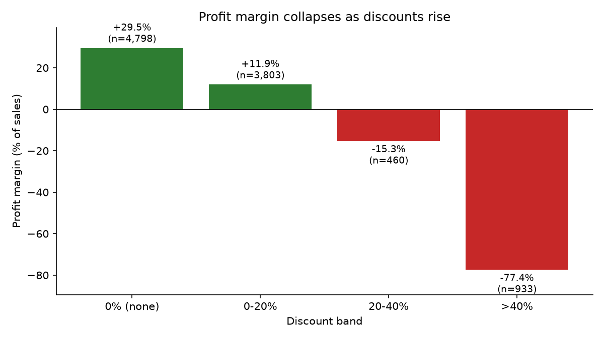

# Retail Sales & Profitability Diagnostic

An end-to-end analytics project on **9,994 retail transaction records**: SQL diagnostics in **SQLite**, customer
segmentation with **K-Means (RFM)**, a **Holt-Winters** sales forecast, and a **3-page Power BI dashboard** package
with custom DAX measures.

**Business question:** Where is this retailer losing margin, which customers matter most, and what will sales look like next year?

## Headline results

| | Finding |
|---|---|
| **Margin erosion** | Profit margin is **+29.5%** on undiscounted lines but turns negative once discounts pass 20%: **-15.3%** for 20-40% discounts and **-37.3%** across all lines above 20% |
| **Size of the problem** | Lines discounted above 20% are only 13.9% of order lines and 15.8% of sales, but lose **$135K**. Removing the losses would lift profit about 47% |
| **Loss-making sub-categories** | **Tables** (-$17.7K), **Bookcases** (-$3.5K) and **Supplies** (-$1.2K). Tables and Bookcases lose money only on >20% discount lines |
| **Customers** | **793 customers in 4 RFM segments.** Champions are 31% of customers but 52% of sales; 33% of customers are "At risk" |
| **Forecast** | Holt-Winters projects **FY2018 sales of about $778K** (+6% vs 2017); back-test MAPE 20.8% vs 24.5% for a seasonal-naive benchmark |



Full write-up with tables and recommendations: [`reports/findings.md`](reports/findings.md)

## Tech stack
Python (pandas, NumPy, Matplotlib) · SQL / SQLite · scikit-learn (K-Means) · statsmodels (Holt-Winters) · Power BI / DAX

## Project structure
```text
retail-sales-profitability-diagnostic/
├── data/
│   └── raw/Superstore.csv          # public Superstore sample dataset (see data/raw/README.md)
├── sql/                            # 9 SQL queries (KPIs, discount bands, sub-categories, window functions, RFM base)
├── src/
│   ├── 01_load_to_sqlite.py        # clean CSV, validate, load to SQLite
│   ├── 02_sql_diagnostics.py       # run SQL files, save tables and charts
│   ├── 03_rfm_kmeans.py            # RFM features, choose k, K-Means, segment naming
│   ├── 04_holt_winters_forecast.py # back-test, final fit, 4-quarter projection
│   ├── 05_export_powerbi.py        # model-ready CSVs for Power BI
│   ├── 06_validate_results.py      # asserts every headline number
│   └── run_all.py                  # runs the whole pipeline
├── powerbi/
│   ├── data/                       # CSV extracts
│   ├── dax_measures.md             # data model + all DAX measures
│   └── README.md                   # page-by-page dashboard build guide
├── outputs/
│   ├── charts/                     # 9 PNG charts
│   └── tables/                     # result tables (CSV)
├── reports/findings.md             # findings, recommendations, limitations
├── .github/workflows/              # CI: runs the full pipeline on every push
├── requirements.txt
└── LICENSE
```

## How to run
```bash
python -m venv venv
venv\Scripts\activate          # Windows  (Mac/Linux: source venv/bin/activate)
pip install -r requirements.txt
python src/run_all.py
```
The pipeline rebuilds the SQLite database, all tables and charts, the Power BI extracts, and then runs
`06_validate_results.py`, which fails if any headline number changes.

## Method summary
1. **Load and validate.** The data is cleaned, dates are parsed to ISO format, and assertions check 9,994 rows, 793 customers and no missing values. It is loaded into SQLite.
2. **SQL diagnostics.** Discount bands, threshold tests, sub-category profitability (flagging loss-makers), a CTE to split loss-makers by discount group, a `LAG()` window function for YoY growth, and top loss-making products.
3. **RFM + K-Means.** Recency, frequency and monetary value per customer; log transform and standardisation; elbow and silhouette shown; k = 4 chosen for interpretability; segments named from their profiles.
4. **Holt-Winters.** Monthly sales, a 2017 hold-out back-test against four configurations and a seasonal-naive benchmark, final fit on all 48 months, and a 12-month (4-quarter) projection with 80% simulation intervals.
5. **Power BI.** Clean CSV extracts, a date dimension, tested DAX measures and a 3-page build guide.

## Notes and limitations
- **Data:** the public Superstore sample dataset (a fictional retailer), not proprietary data. Currency is US dollars.
- **Discount finding:** the +29.5% is the margin on undiscounted lines and the -15.3% is the 20-40% discount band. Across *all* lines above 20% the margin is -37.3%. This is observational, so it shows association rather than proven causation.
- **Supplies** loses money without any heavy discounting, so its cause lies elsewhere (likely cost or pricing).
- **Segmentation:** silhouette score is 0.255, so segments overlap. They are a practical grouping, not sharply separated clusters.
- **Forecast:** only four years of history; the model improves modestly on the naive benchmark. Use the intervals, not just the point estimate.
- **Power BI:** a `.pbix` file cannot be generated from code. This repo includes the data, model and DAX; build steps are in [`powerbi/README.md`](powerbi/README.md). Add your finished `.pbix` and screenshots to `powerbi/`.
